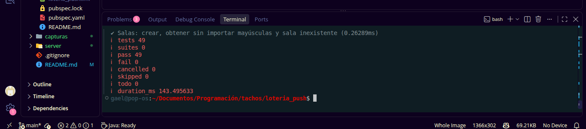
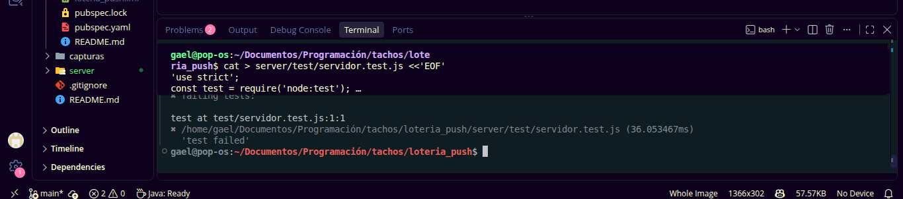
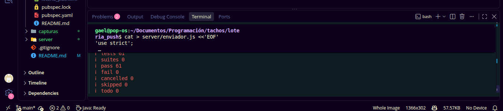
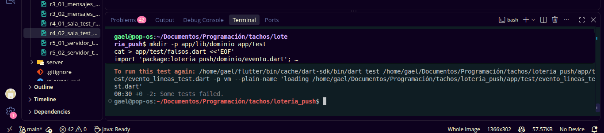
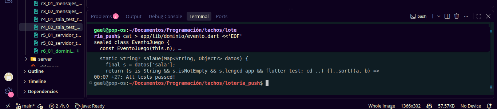
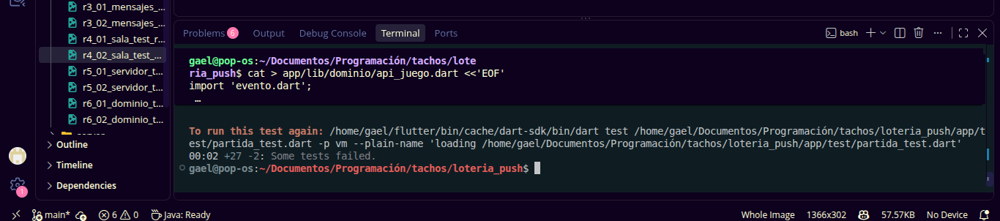
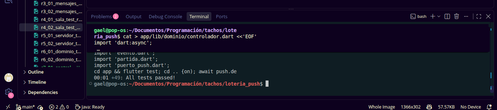
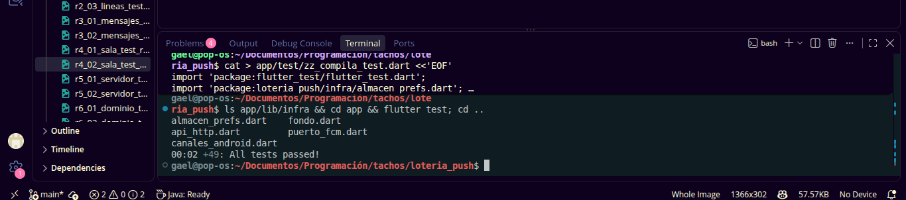
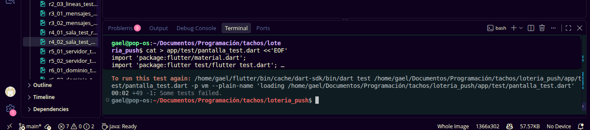
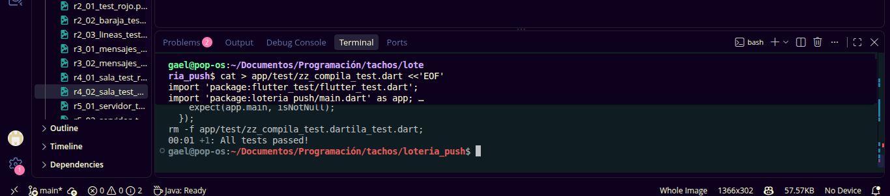

# Lotería Push

Manual TDD: notificaciones push (Firebase Cloud Messaging) en Flutter con un servidor Node.

- Alumno: Aguilar Ortiz Gael Alejandro
- Grupo: GTID241
- Matrícula: 1225100273
- Materia: Desarrollo Móvil · UTNG

### Ronda 1. Firebase configurado

### Ronda 1. Firebase configurado

### Ronda 1. Firebase configurado

### Ronda 2. Baraja: prueba en rojo

### Ronda 2. Baraja: pruebas en verde

### Ronda 2. Líneas ganadoras: prueba en rojo

### Ronda 3. Mensajes: prueba en rojo

### Ronda 3. Mensajes: pruebas en verde

### Ronda 4. Sala: prueba en rojo

### Ronda 4. Sala: pruebas en verde

### Ronda 5. Servidor HTTP: prueba en rojo

### Ronda 5. Servidor HTTP: prueba en rojo

### Ronda 5. Servidor HTTP: 61 pruebas en verde

### Ronda 6. Eventos, patrones y partida: prueba en rojo

### Ronda 6. Eventos, patrones y partida: pruebas en verde

### Ronda 7. Controlador: prueba en rojo

### Ronda 7. Controlador: pruebas en verde

### Ronda 8. Adaptador de Firebase, API HTTP y almacén

### Ronda 9. Pantallas: prueba en rojo

### Ronda 9. Pantallas: pruebas en verde

