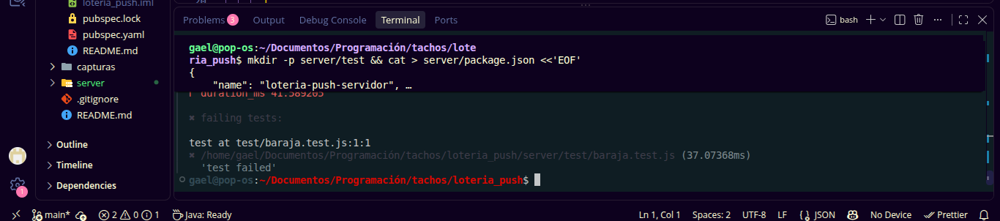

# Lotería Push

Manual TDD: notificaciones push (Firebase Cloud Messaging) en Flutter con un servidor Node.

- Alumno: Aguilar Ortiz Gael Alejandro
- Grupo: GTID241
- Matrícula: 1225100273
- Materia: Desarrollo Móvil · UTNG

### Ronda 1. Firebase configurado

### Ronda 1. Firebase configurado

### Ronda 1. Firebase configurado

### Ronda 2. Baraja: prueba en rojo

### Ronda 2. Baraja: pruebas en verde

